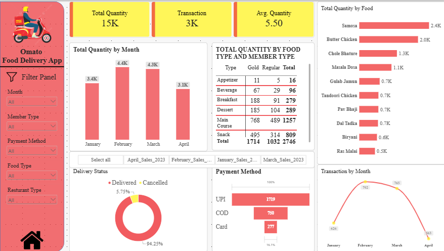
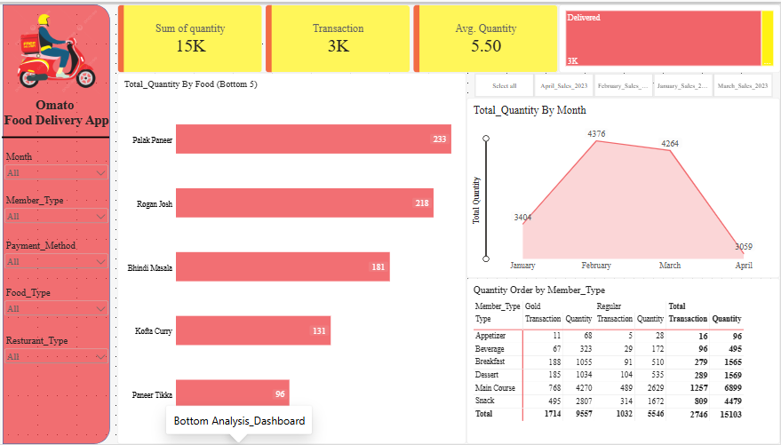
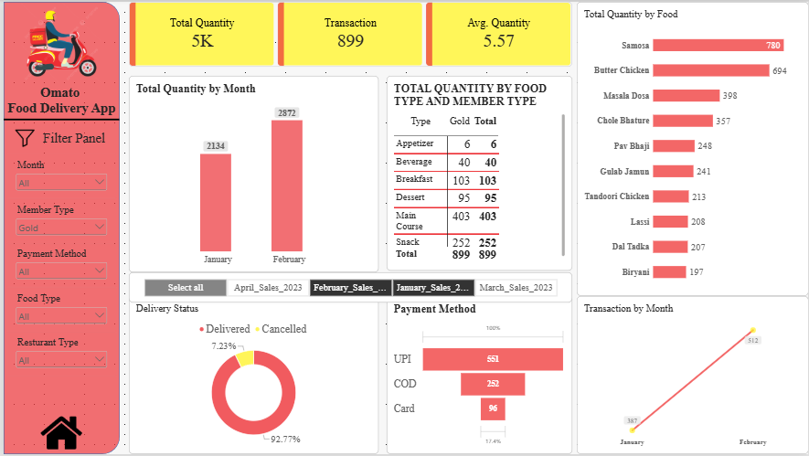
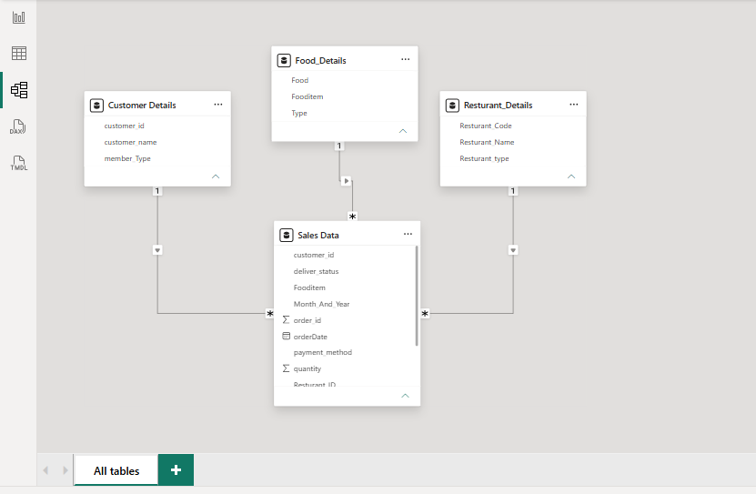
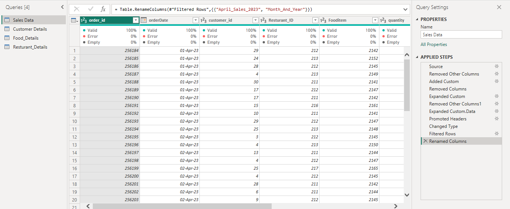

# Omato Food Delivery App Analytics Dashboard (Power BI)

## Project Overview
An interactive 2-page Power BI dashboard analyzing 2,746 food delivery transactions over 4 months (January to April). Data was cleaned and transformed in Power Query, then modeled and visualized in Power BI to show delivery performance, payment preferences, customer membership behavior, and top and bottom selling foods.

## Business Questions Answered
- What is the overall delivery success rate?
- Which payment method do customers prefer?
- Which foods sell the most, and which sell the least?
- How do Gold and Regular members compare in orders and quantity?
- How do transactions and quantity change month by month?

## Tools Used
- Power Query (data cleaning and transformation)
- Power BI Desktop (data modeling, DAX measures, dashboard design)
- Microsoft Excel (source data)

## Dataset
- Source: [add dataset source, e.g. Kaggle link or "practice dataset"]
- Records: 2,746 transactions
- Period: 4 months (January to April)
- Main fields: Order Date, Food Item, Food Type, Quantity, Payment Method, Delivery Status, Member Type, Restaurant Type

## Data Cleaning (Power Query)
- Handled missing values and corrected data types
- Combined the sales, customer, and restaurant tables into one clean data model
- Created a Month and Year field for time-based analysis
- [Add any other steps you performed]

## Dashboard Pages

### Page 1: Main Dashboard
- **KPI cards:** Transactions, Total Quantity, Average Quantity
- **Top foods** by total quantity (bar chart)
- **Payment Method** breakdown (funnel chart)
- **Delivery Status** (donut chart)
- **Monthly trend** of transactions (line chart) and quantity (column chart)
- **Matrix:** quantity by food type and member type

### Page 2: Bottom Analysis
- **Bottom 5 foods** by total quantity (bar chart)
- **Delivery Status** distribution (treemap)
- **Total Quantity by Month** (area chart)
- **Matrix:** quantity ordered by member type and food type

### Slicers (both pages)
Member Type, Restaurant Type, Payment Method, Food Type, and Month and Year, with a Filter Panel.

## Key Insights
- **94.25%** of orders were delivered successfully
- **UPI** was the leading payment method with **1,719 orders**
- **Samosa** was the top-selling food item
- **Gold members** placed 1,714 of 2,746 transactions (about 62%), compared with 1,032 from Regular members
- **Main Course** was the top food type with 6,899 units, followed by Snacks with 4,479
- **Appetizers** had the lowest quantity at only 96 units

## Screenshots

### Main Dashboard

### Bottom Analysis

### Filtered View

### Data Model

### Power Query Steps

## Repository Files
- `Omato_Food_Delivery_Dashboard.pbix` - Power BI report file
- `Omato_Food_Delivery_Dashboard.pdf` - PDF export of both dashboard pages
- `01_main_dashboard.png` to `05_power_query_steps.png` - screenshots

## How to Open
1. Download `Omato_Food_Delivery_Dashboard.pbix`.
2. Open it in Power BI Desktop (free for Windows).
3. Use the slicers to filter the dashboard.

## Author
**Animesh Mishra**
- Email: mishra.animesh2005@gmail.com
- LinkedIn: [Animesh Mishra](https://www.linkedin.com/in/animesh-mishra-da/)
- GitHub: [animesh-mishra-da](https://github.com/animesh-mishra-da)
